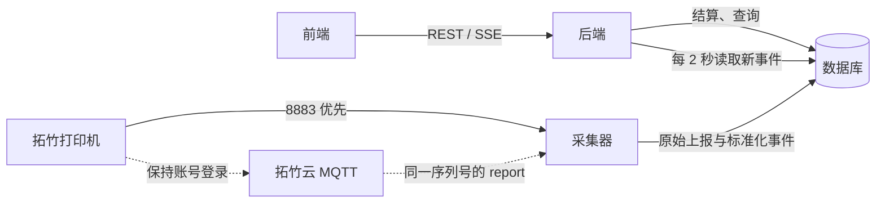
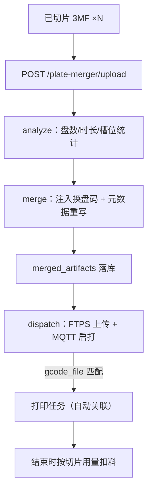
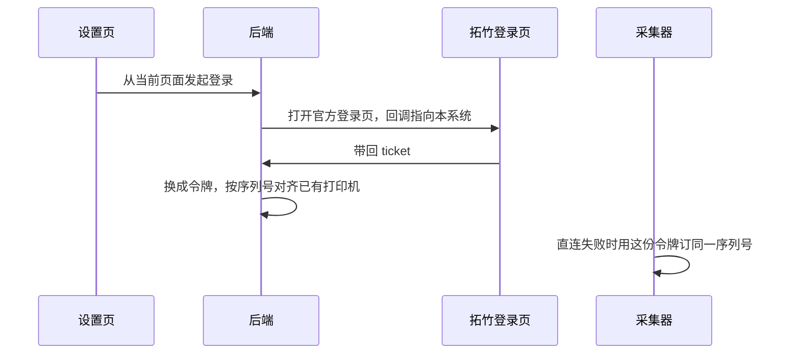
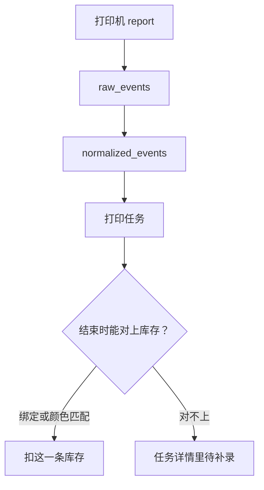

# 架构

一台打印机在库里只有一行，序列号是唯一键。采集端同时只维持这一行的一个连接：局域网端口通就直连，否则走拓竹云上的同一序列号。

交互图：[system.html](diagrams/system.html)

## 组件

| 部分 | 目录 | 做什么 |
|---|---|---|
| 前端 | `frontend/` | 页面、PWA、拍照识别、数字孪生（three.js）、合盘向导 |
| 后端 | `backend/` | REST、SSE、打印结束后扣库存、合盘算法（`app/plate_merger/`）、设备控制协议、HMS 码表 |
| 采集器 | `collector/` | 每台打印机一个 MQTT 连接，41 个标准化字段 + HMS 事件 |
| 数据库 | SQLite 或 PostgreSQL | 事件、打印机、库存、任务、合盘产物（`merged_artifacts`）。没有单独的消息队列 |

## 生产链路（合盘 → 下发 → 扣料）

## 登录与合并

从哪一页点的登录，回调就回到哪一页。令牌加密存在 `bambu_cloud_sessions`，不写进打印机表。打印机表只增加「当前通路」：局域网或云端。

## 扣库存

云端和局域网读到的是同一类上报，所以扣库存的规则不用分两套。
