# 界面

截图是界面示例（演示数据）。手机和 iPad 竖屏用底部六个标签，更宽的屏幕用顶部导航。

| 页面 | 路径 | 能做什么 |
|---|---|---|
| 仪表盘 | `/` | 在线数、正在打印、今日与近 7 天消耗 |
| 打印机 | `/printers` | 扫描或手填添加，查看 AMS 四槽，绑定库存。卡片上能看到当前走局域网还是云端 |
| 设备详情 | `/printers/[id]` | 实时数据（温度/层数/风扇/速度）、数字孪生 3D、设备控制、HMS 故障弹窗 |
| 生产 | `/production` | 合盘向导、产物库、换盘码管理三个入口 |
| 合盘向导 | `/production/merge` | 多选 3MF → 自动统计（盘数/时长/槽位）→ 配置换盘码 → 生成合盘文件 |
| 产物库 | `/production/gcodes` | 合盘产物列表（含登记状态与耗材清单），下载 / 删除 / 下发打印 |
| 库存 | `/stocks` | 按材质 + 颜色 + 品牌维护库存。每条是一卷耗材，轴心显示剩余百分比 |
| 库存详情 | `/stocks/[id]` | 手改剩余克数，查看这条库存对应的打印消耗和流水 |
| 任务历史 | `/jobs` | 按打印机、状态、关键字筛选 |
| 任务详情 | `/jobs/[id]` | 扣料记录、待补录、撤销 |
| 报告 | `/reports` | 按日、周、月看分色柱状图和估算成本 |
| 设置 | `/settings` | 拓竹云账号、品牌单价、颜色映射、材料调试 |
| 换盘码管理 | `/settings/swap-codes` | 三档预设切换、G-code 渲染预览与耗时估算、空跑测试文件生成 |
| 颜色映射 | `/settings/color-mappings` | 把 AMS 颜色码写成库存颜色名 |
| 材料调试 | `/settings/material-debug` | 核对颜色码或材质能匹配到哪些库存 |
| 品牌单价 | `/settings/prices` | 按品牌填写元/千克，供报告估算成本 |
| 拓竹云账号 | `/settings/cloud` | 登录拓竹账号，按序列号合并到已有打印机 |
| 离线 | `/offline` | 网络不可用时的兜底页 |

> 新增的生产模块与设备详情页截图待补（上表功能已上线）。

## 桌面

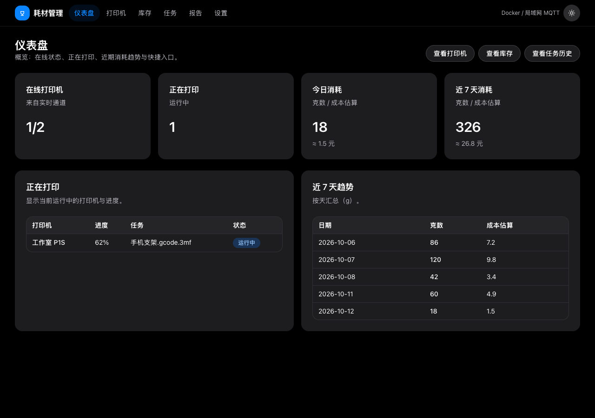

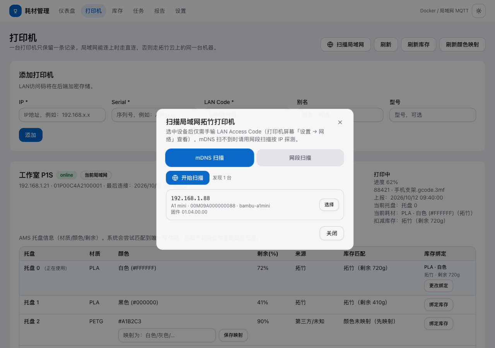

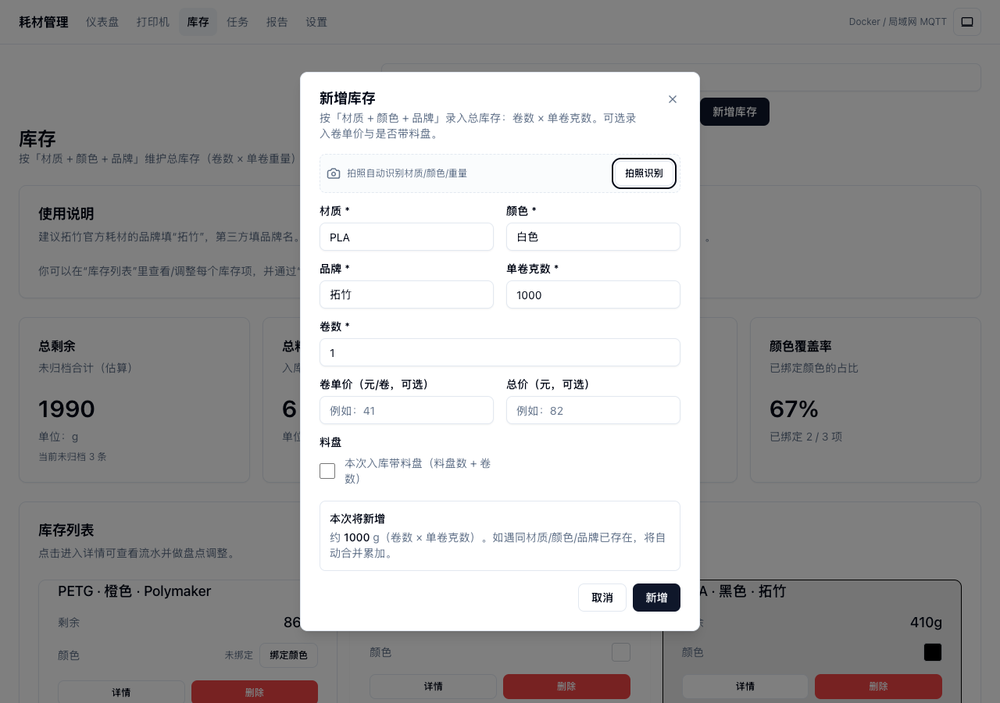

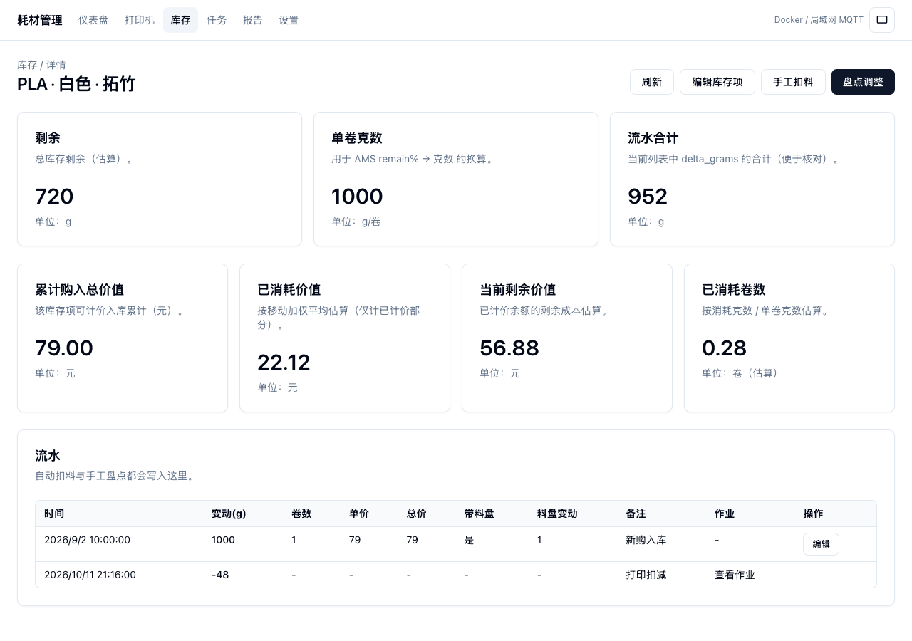

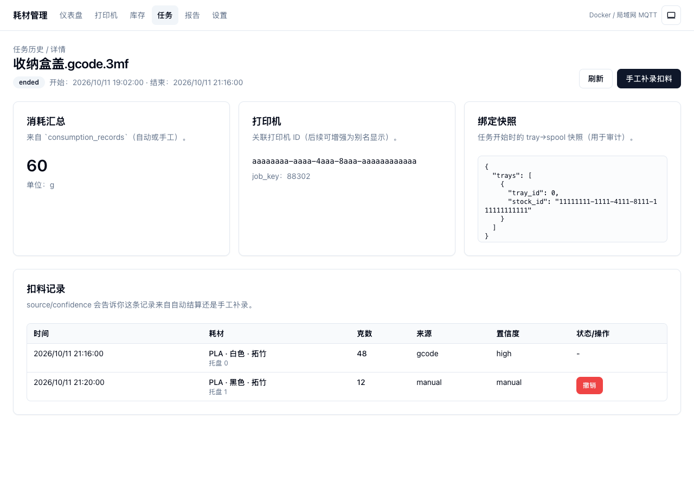

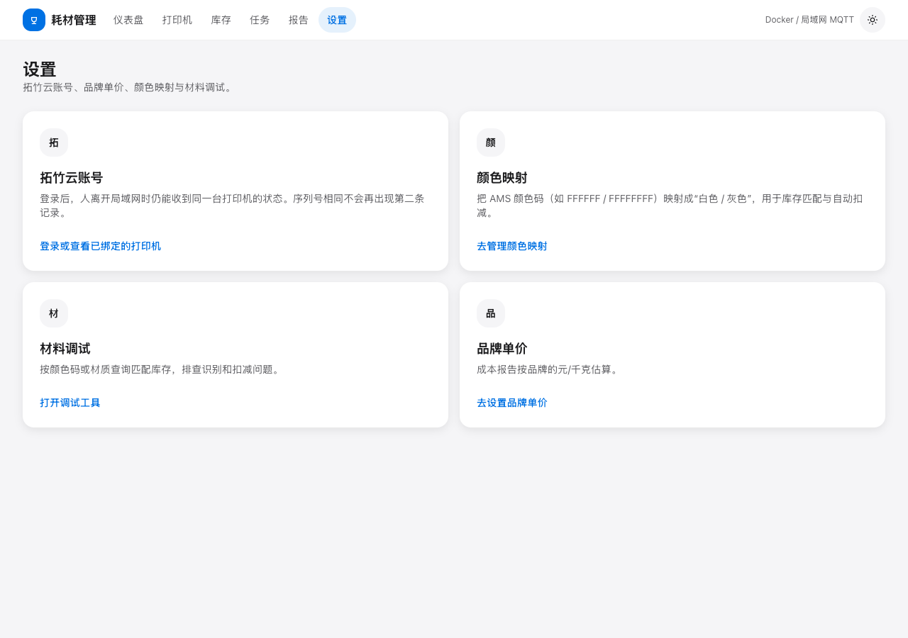

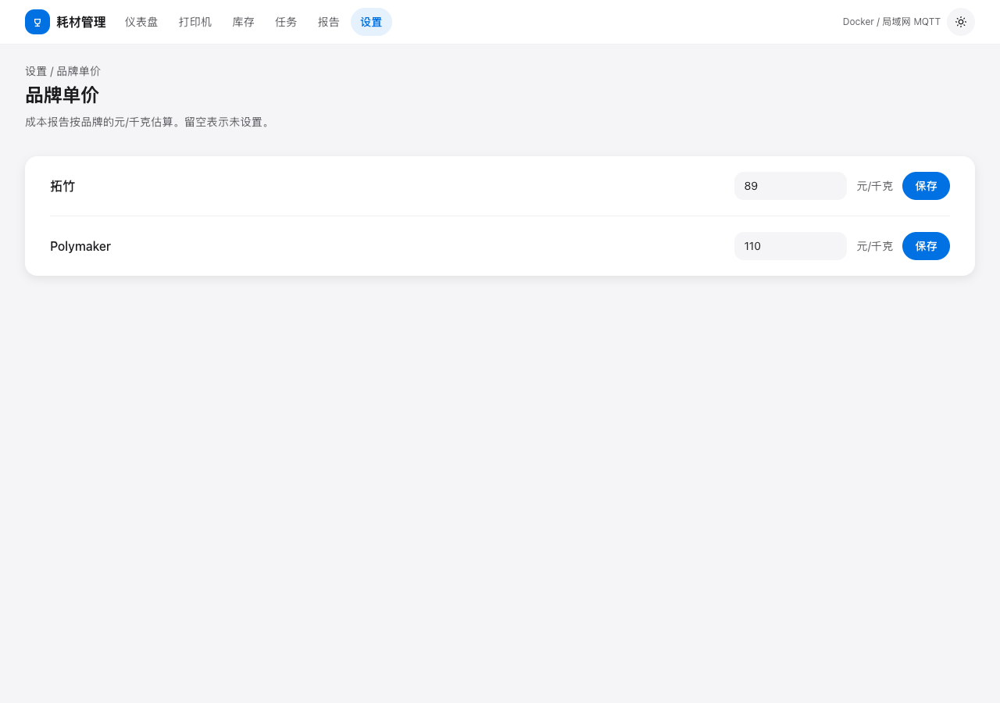

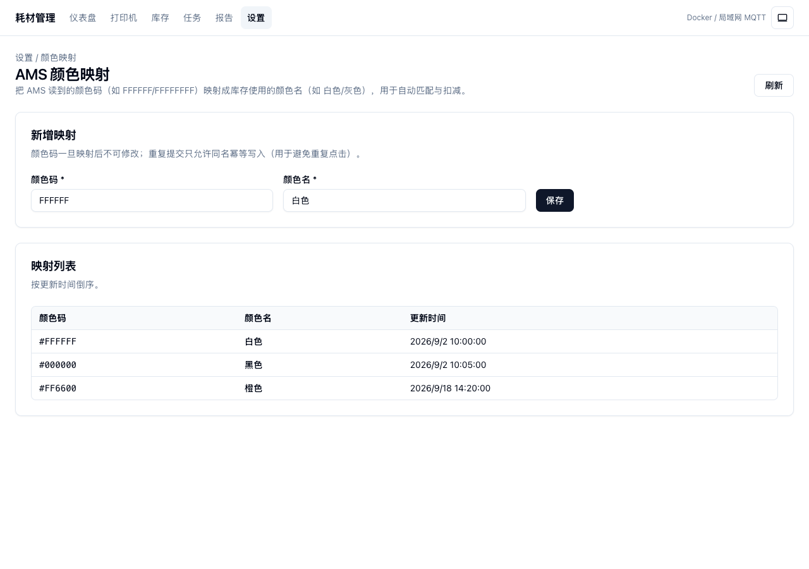

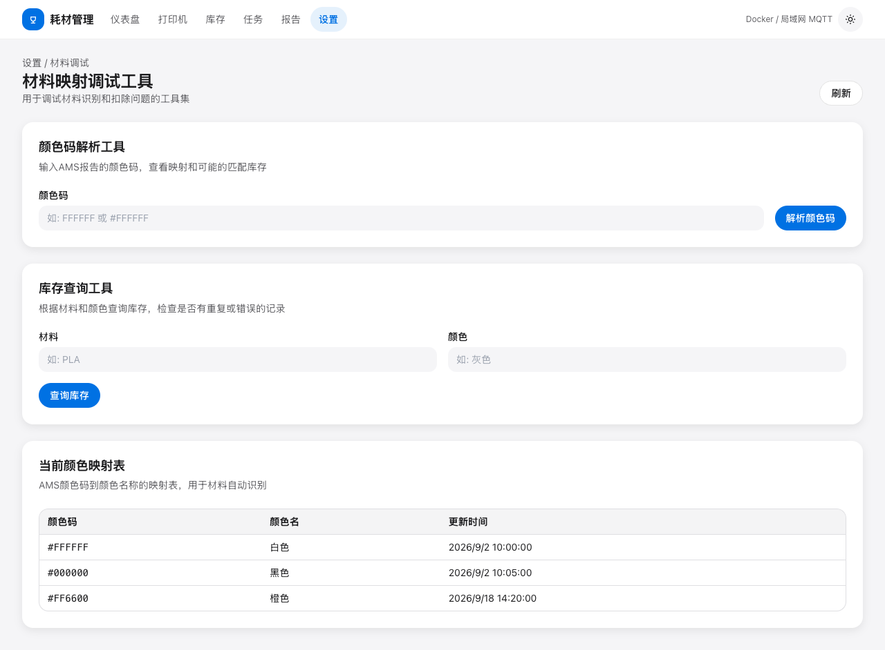

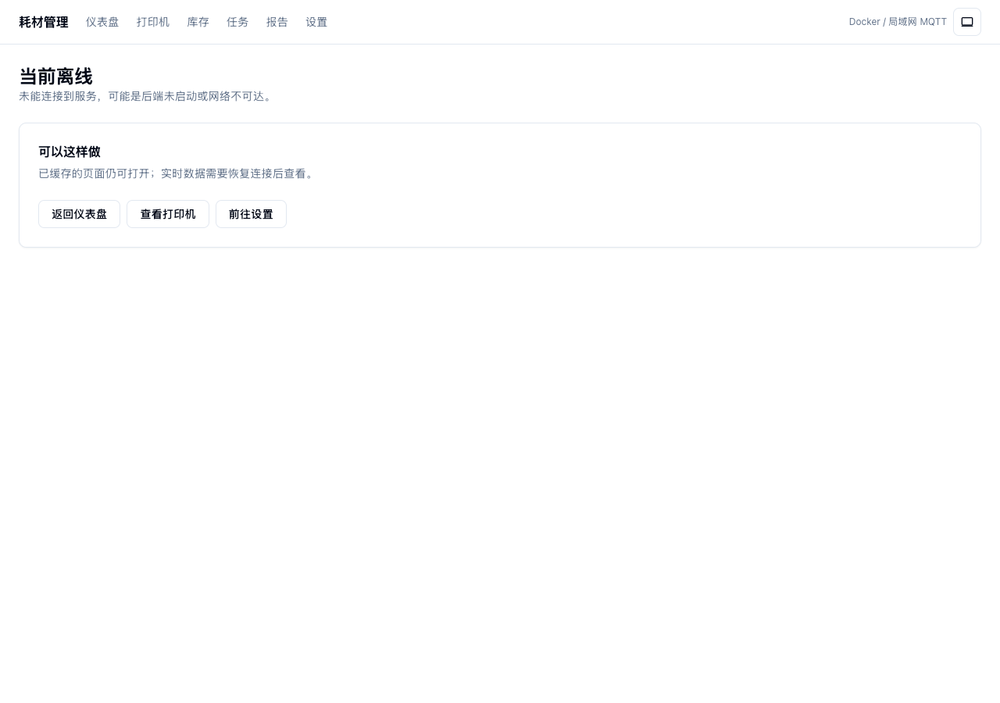

## 手机与 iPad

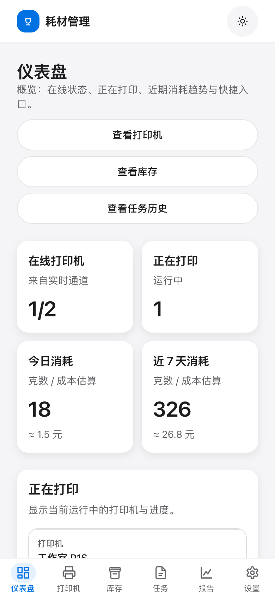
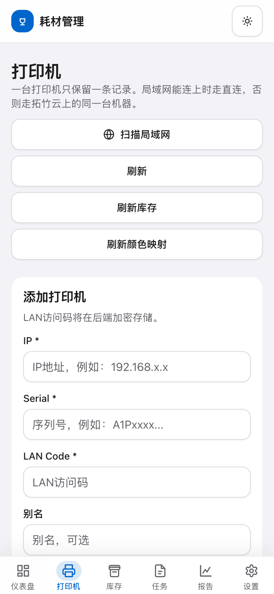
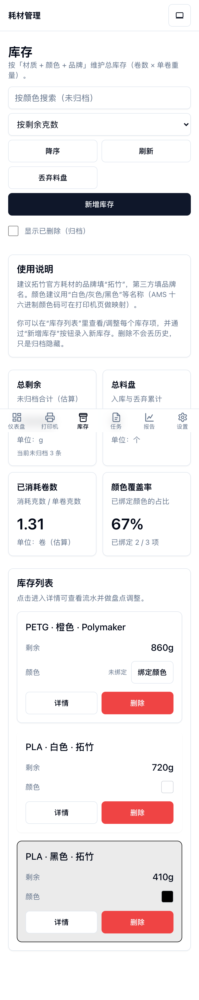

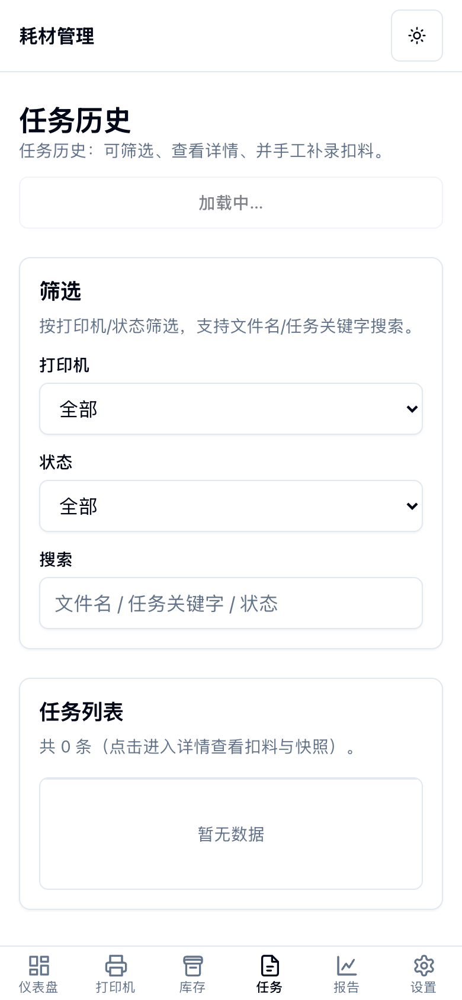
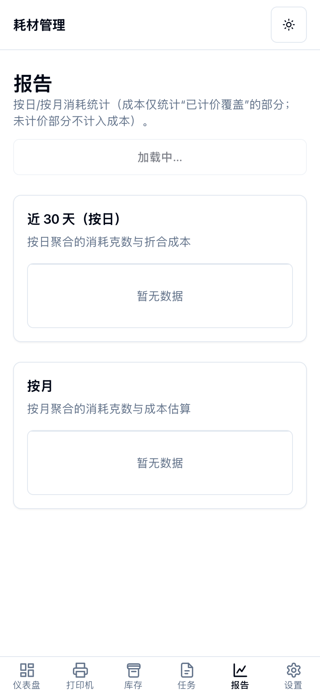
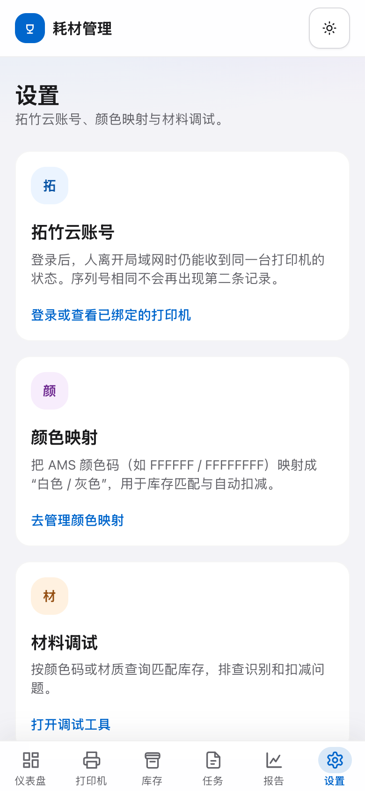

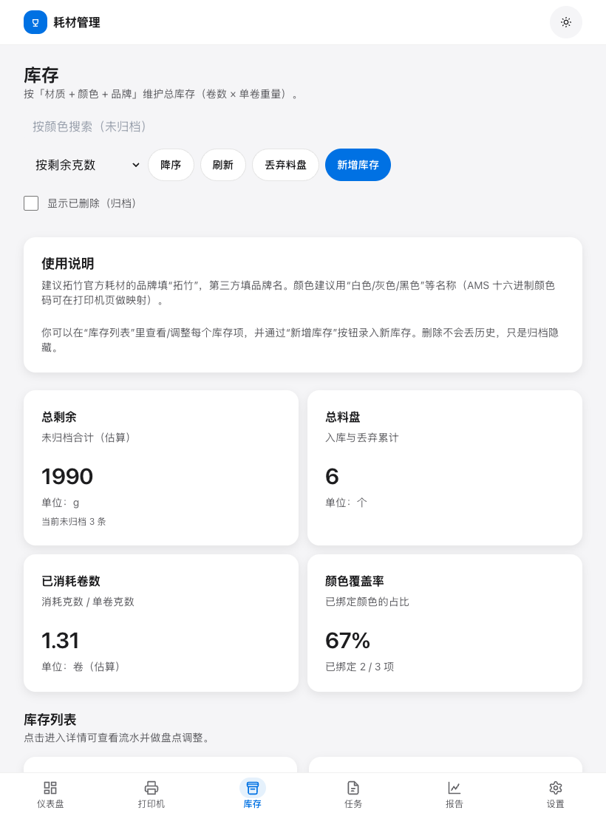
